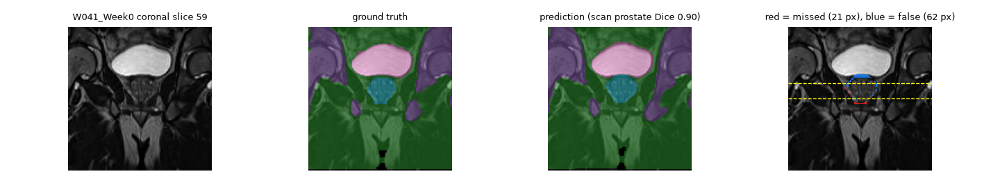
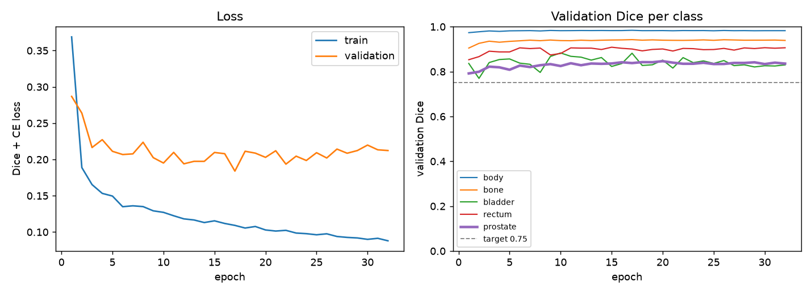
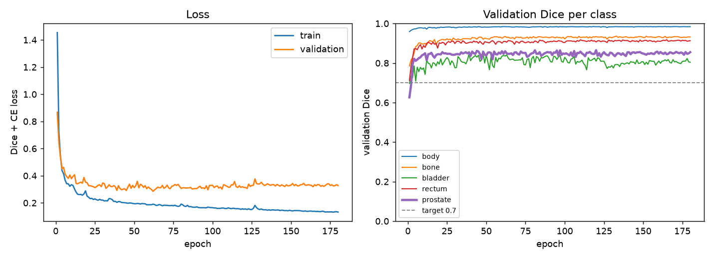
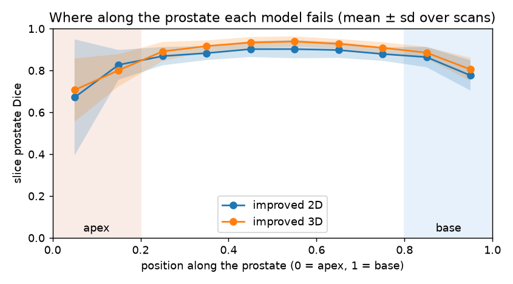
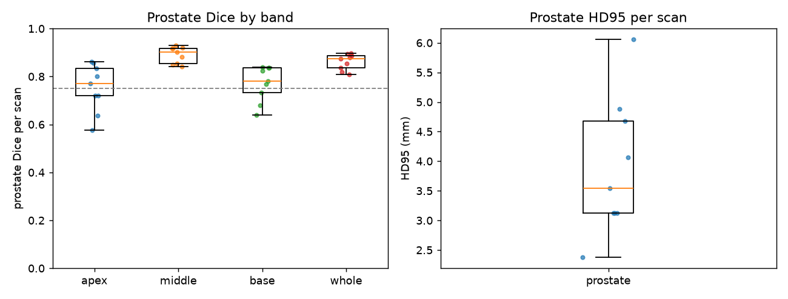
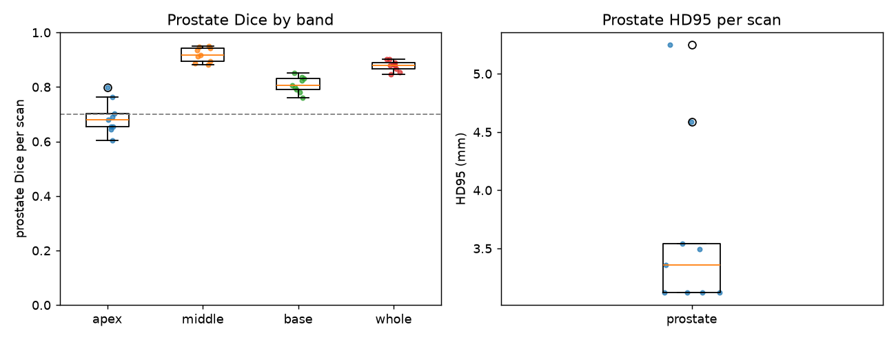
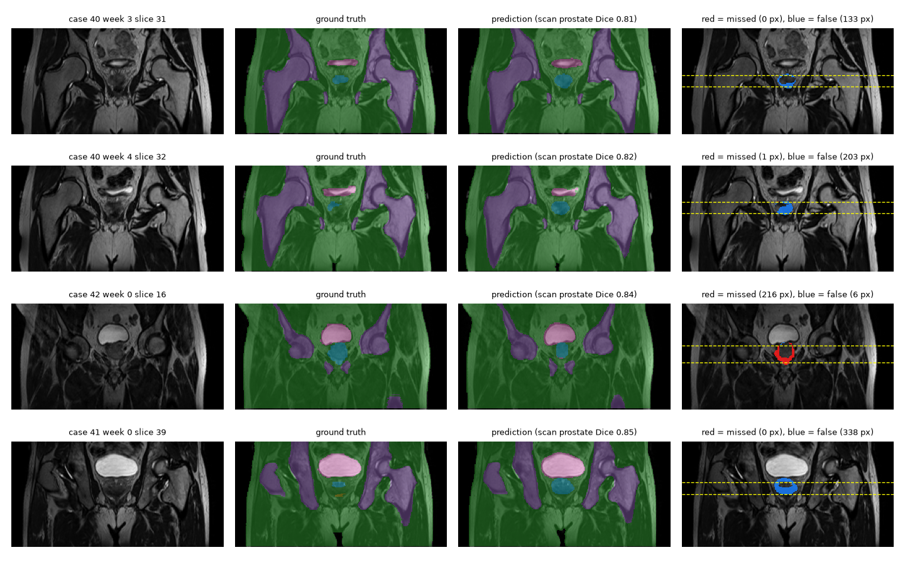

# 2D vs 3D Improved U-Net for Prostate Segmentation on HipMRI: Does Volumetric Context Fix Boundary Failures?

## Table of Contents

1. [Overview](#1-overview)
2. [Feasibility Review](#2-feasibility-review)
3. [Repository Structure and Usage](#3-repository-structure-and-usage)
4. [Dependencies and Reproducibility](#4-dependencies-and-reproducibility)
5. [Data and Pre-processing](#5-data-and-pre-processing)
6. [Train / Validation / Test Splits](#6-train--validation--test-splits)
7. [Models and Training](#7-models-and-training)
8. [Hyperparameter Tuning (3D)](#8-hyperparameter-tuning-3d)
9. [Results: 2D Baseline vs 3D](#9-results-2d-baseline-vs-3d)
10. [Resource Profiling](#10-resource-profiling)
11. [Error Autopsy](#11-error-autopsy)
12. [Discussion: Answering the Research Dilemma](#12-discussion-answering-the-research-dilemma)
13. [Recommendation to the Project Manager](#13-recommendation-to-the-project-manager)
14. [Future Work](#14-future-work)
15. [References](#15-references)
16. [Artificial Intelligence Usage Disclosure](#16-artificial-intelligence-usage-disclosure)

## 1. Overview

### 1.1 The Problem

In prostate radiotherapy, the prostate, bladder and rectum must be contoured on every planning MRI. Automatic segmentation can draft these contours, but its usual quality measure, a single global Sørensen–Dice score, can hide the failures that matter clinically: a model can score well on the wide central slices while failing at the **base** (top, against the bladder) and **apex** (bottom) of the prostate, or leaking across the millimetre-thin boundary into the **rectal wall** or **bladder**. Leakage into these organs risks radiation proctitis or cystitis; under-contouring risks missing tumour. This project asks whether **3D volumetric context** fixes these boundary failures compared with a 2D slice-by-slice model, or whether it only smooths the easy central slices while costing several times the GPU memory and training time ([Section 12](#12-discussion-answering-the-research-dilemma)).

### 1.2 The Algorithm

Both models are the **Improved U-Net** of Isensee et al. [2]: a U-shaped encoder–decoder in which every encoder level has a residual _context module_ (two convolutions with dropout, added back to their input), the resolution is halved by stride-2 convolutions, the decoder doubles it again with _upsampling modules_ and refines the joined skip connections with _localisation modules_, and _deep supervision_ adds segmentation maps from three decoder levels. Instance normalisation and leaky ReLU are used throughout. The **2D baseline** segments individual coronal slices (HipMRI 2D data); the **3D model** segments whole prostate-centred volumes (HipMRI 3D data). Both are built from the same building blocks, which only swap 2D for 3D layers, so the comparison changes nothing but the spatial dimension (architecture details in [Section 7.1](#71-architecture)).

### 1.3 How It Works

Both models go through the same four steps, so any difference in the results comes from 2D versus 3D context alone.

1. **Split the data by patient.** Each patient's scans all go into one set (training, validation or test), so the models are never tested on a patient they have seen. The 3D split copies the provided 2D split, so both models are tested on the **same patients and scans** (see [Section 6](#6-train--validation--test-splits)).
2. **Prepare the images.** Each scan's intensities are standardised (z-scored) so that scans from different sessions look alike. 2D slices are cropped to 256 × 128; 3D volumes are cropped to a 128 × 128 × 128 box around the prostate, positioned using the training labels only. During training, images are randomly rotated, scaled and brightened so the network learns to handle variation (see [Section 5](#5-data-and-pre-processing)).
3. **Train the network.** The loss combines Dice, which rewards overlap and so stops the network ignoring the tiny prostate (under 0.5% of the image), with cross-entropy, which checks every voxel. Training stops once the prostate score on the validation patients has not improved for a set number of epochs, and the best checkpoint is kept (see [Section 7](#7-models-and-training); the 3D settings were tuned in [Section 8](#8-hyperparameter-tuning-3d)).
4. **Evaluate each test scan as a whole.** The 2D model's slice predictions are stacked back into one block per scan, and both models are then scored per scan with the same code. Both contain the whole prostate (the true prostate volume is identical in the 2D and 3D evaluations of every test scan). Each metric answers one question (results in [Section 9](#9-results-2d-baseline-vs-3d)):
   - **Dice** (0–1): how well does the predicted prostate overlap the true one overall?
   - **Apex / middle / base Dice:** the same, measured separately in the bottom 20%, middle and top 20% of the prostate, which shows _where_ the errors are.
   - **HD95** (mm): how far does the predicted outline stray from the true outline? (The 95th percentile of the boundary distances, so a few outlier points don't dominate.)
   - **Leakage** (ml): how much prostate was predicted inside the rectum or bladder, the errors that would harm healthy organs in radiotherapy?
   - **Pieces:** is the predicted prostate one connected shape, like the real one, or broken into fragments?

<p align="center">
  
  <br><em><b>Figure 1.</b> Example output of the 3D model on a test scan (W041, coronal slice): input, ground truth, prediction, and errors (red = missed prostate, blue = false prostate; dashed lines = edges of the apex and base bands). </em>
</p>

### 1.4 Key Results

**Table 1.** Key test results, mean ± sd over 3 seeds; both models evaluated on the same 9 scans from 3 patients. Bold marks the better model.

|                                       | 2D Improved U-Net (baseline)    | 3D Improved U-Net                   |
| ------------------------------------- | ------------------------------- | ----------------------------------- |
| Prostate Dice                         | 0.862 ± 0.008 (target ≥ 0.75 ✓) | **0.876 ± 0.005** (target ≥ 0.70 ✓) |
| Apex / middle / base Dice             | 0.735 / 0.895 / 0.772           | 0.712 / **0.917** / 0.786           |
| HD95 median                           | 4.02 ± 0.59 mm                  | **3.20 ± 0.14 mm**                  |
| Prostate leaked into rectum / bladder | 0.08 / **0.27** ml              | **0.02** / 0.42 ml                  |
| Separate prostate pieces (truth = 1)  | 1.33                            | **1.00**                            |
| Peak training VRAM                    | **0.68 GB**                     | 3.87 GB (5.7×)                      |

**In short:** 3D context gives a consistent but modest gain (3D beat 2D in all three seed pairs), removes fragmented predictions and greatly reduces rectal leakage, but it does **not** fix the apex, which remains the main failure mode of both models (see [Section 12](#12-discussion-answering-the-research-dilemma)).

## 2. Feasibility Review

**Proposal:** first build a 2D Improved U-Net on the HipMRI 2D slices (Normal difficulty, prostate Dice ≥ 0.75), then a 3D Improved U-Net on the downsampled 3D volumes (Hard difficulty, prostate Dice ≥ 0.70), with the 2D model as its baseline. **The question:** does 3D context remove the prostate base/apex and rectum/bladder boundary errors, or does it only smooth easy central slices at several times the GPU cost?

### 2.1 User Need, Scope and Acceptance Criteria

**User:** a radiotherapy planner or MR physicist who contours the prostate target volume. **Purpose:** an annotation assistant that drafts prostate, bladder and rectum contours for the specialist to review and correct. **Scope:** an offline research prototype.

**Table 2.** Acceptance criteria and how each was tested.

| Acceptance criterion                                                                               | Test                                                                                                  |
| -------------------------------------------------------------------------------------------------- | ----------------------------------------------------------------------------------------------------- |
| 2D Improved U-Net prostate Dice ≥ 0.75                                                             | Per-class Dice and IoU on the held-out test split                                                     |
| 3D Improved U-Net prostate Dice ≥ 0.70                                                             | Per-class Dice and IoU on the held-out test patients                                                  |
| Boundary dilemma: 3D only counts as a gain if it improves the base and apex, not just overall Dice | Prostate Dice in the top and bottom 20% of each prostate vs the central slices, for both models; HD95 |
| Less leakage into the rectum and bladder                                                           | Predicted-prostate volume inside the true rectum / bladder, per scan                                  |
| Resource: 3D training fits one comp3710 GPU                                                        | Peak VRAM and inference time per scan for both models; the 3D : 2D ratio                              |

### 2.2 Model Choice and Course Concepts

**Table 3.** The two planned stages.

|              | Stage 1: 2D Improved U-Net                                              | Stage 2: 3D Improved U-Net                                      |
| ------------ | ----------------------------------------------------------------------- | --------------------------------------------------------------- |
| Difficulty   | Normal (baseline and fallback)                                          | Hard (main model)                                               |
| Data         | `keras_slices_data` 2D slices, provided train / validate / test folders | `semantic_MRs` + `semantic_labels_only`, patient-level split    |
| Input        | 256 × 128 slices, z-scored per scan                                     | Fixed 128 × 128 × 128 crop around the pelvis, z-scored per scan |
| Convolutions | 3 × 3                                                                   | 3 × 3 × 3 (volumetric residual units)                           |

Both follow the Improved U-Net (Isensee et al., 2018): residual context modules, stride-2 downsampling, instance normalisation, leaky ReLU, localisation modules and deep supervision, trained with Dice + cross-entropy loss.

- **Encoder–decoder with skip connections** keeps the fine detail needed for millimetre-scale boundaries.
- **Residual units and deep supervision** help gradients reach early layers in a deep network trained on few patients.
- **Dice + cross-entropy loss** stops the model ignoring the prostate, which is under 2% of the scan.
- **Augmentation and early stopping** (small rotations, scaling, intensity jitter) limit overfitting.

The 2D and 3D models share loss, metrics and test patients, so differences come from spatial context alone.

### 2.3 Preliminary Evidence: Initial Data Audit

**Table 4.** Initial data audit of the 2D slices and 3D volumes.

| Check                          | 2D slices                                                             | 3D volumes                                                                                    |
| ------------------------------ | --------------------------------------------------------------------- | --------------------------------------------------------------------------------------------- |
| Files                          | 11,460 train / 660 validate / 540 test slices (211 scans × 60 slices) | 211 volumes from 38 patients (1–8 scans each)                                                 |
| Shape and spacing              | 256 × 128 (one scan's 60 slices are 256 × 144)                        | 256 × 256 × 128 (one is × 144); about 1.41–1.88 mm in-plane × 1.56 mm slices; orientation LPS |
| Labels                         | 0–5 in every split (0 = background … 5 = prostate)                    | 0–5; prostate 0.10%, rectum 0.14%, bladder 0.57%, bone 3.4%, body 35.5% of voxels             |
| Prostate share                 | 0.43% / 0.50% / 0.34% of pixels; 36–39% of slices contain prostate    | 0.023–0.311% of voxels (median 0.086%); 8.4–99.4 ml (median 31 ml)                            |
| Patients shared between splits | None: the split is already by case (31 / 4 / 3 patients)              | Split by patient ID                                                                           |

### 2.4 Risks, Budget and Fallback

**Table 5.** Risks identified before training, and the planned mitigation for each.

| Risk                                                       | Mitigation                                                                                                      |
| ---------------------------------------------------------- | --------------------------------------------------------------------------------------------------------------- |
| 3D model runs out of GPU memory                            | 128³ pelvic crop, batch size 1–2, mixed precision, fewer base filters                                           |
| Prostate ignored because it is ~0.1% of voxels             | Dice + cross-entropy loss; oversample slices and crops that contain prostate                                    |
| Overfitting: only 31 training patients                     | Augmentation; early stopping on validation Dice                                                                 |
| 2D case IDs do not map to 3D patients                      | Check week counts per case against each 3D patient; if they don't match, use an independent patient-level split |
| Test set of 3 patients is too small to separate the models | Per-scan and per-patient results with their spread; report differences inside the spread as inconclusive        |

**Compute budget:** about 25 GPU-hours on the comp3710 partition (5 for 2D, 15 for 3D, 5 for evaluation and reruns), refined after timing the first epochs. **Fallback:** if the 3D model cannot fit in memory or reach Dice 0.70, submit the 2D Improved U-Net (Normal).

## 3. Repository Structure and Usage

### 3.1 Files

**Table 6.** Files in this repository.

| File         | Purpose                                                                                                                                                                                           |
| ------------ | ------------------------------------------------------------------------------------------------------------------------------------------------------------------------------------------------- |
| `dataset.py` | Data loading, pre-processing, patient-level splitting and augmentation for the 2D slices and 3D volumes ([Section 5](#5-data-and-pre-processing), [Section 6](#6-train--validation--test-splits)) |
| `modules.py` | The 2D and 3D Improved U-Nets, the Dice + cross-entropy loss and the Dice / IoU metric; pure PyTorch ([Section 7](#7-models-and-training))                                                        |
| `train.py`   | Trains, validates, tests and saves a model; plots the loss and validation Dice curves                                                                                                             |
| `predict.py` | Loads a trained model, evaluates it per scan, prints the results and saves the figures; `--compare` builds the 2D-vs-3D tables                                                                    |
| `utils.py`   | Evaluation metrics (Dice, IoU, HD95, apex / middle / base bands, leakage, fragments) and figures, shared by both models                                                                           |
| `figures/`   | Figures used in this README                                                                                                                                                                       |

### 3.2 How to Use the Files

The data folder is set by `DATA_ROOT` at the top of `dataset.py` (default: the HipMRI copy on Rangpur, `/home/groups/comp3710/HipMRI_Study_open`). There are two steps: **train** a model with `train.py`, then **evaluate** it with `predict.py`.

#### Step 1: Train

```bash
python train.py --dim 2d # 2D baseline, default settings
python train.py --dim 3d --lr 5e-4 --epochs 300 --patience 60 --dice-weight 2 --out runs/3d_final_seed42 # final 3D model
```

**Table 7.** `train.py` options.

| Option          | Default                                | What it does                                                                |
| --------------- | -------------------------------------- | --------------------------------------------------------------------------- |
| `--dim`         | `2d`                                   | Which model to train: `2d` or `3d`                                          |
| `--out`         | `runs/improved2d` or `runs/improved3d` | Folder for this run's outputs (use a new name per experiment)               |
| `--epochs`      | 60 (2D), 150 (3D)                      | Maximum number of epochs                                                    |
| `--patience`    | 12 (2D), 30 (3D)                       | Stop early after this many epochs without a better validation prostate Dice |
| `--lr`          | `5e-4`                                 | Starting learning rate (decays to 1% of it)                                 |
| `--dice-weight` | `1.0`                                  | Loss = dice-weight × Dice loss + cross-entropy                              |
| `--seed`        | `42`                                   | Random seed                                                                 |
| `--max-scans`   | all                                    | Use only N scans per split, for a quick test                                |

All other settings (filters, dropout, weight decay, batch size, augmentation) are fixed in `SETTINGS` at the top of `train.py` and saved with every run.

#### Step 2: Evaluate

```bash
python predict.py --checkpoint runs/3d_final_seed42/best.pt # test split
python predict.py --checkpoint runs/3d_final_seed42/best.pt --split validate
python predict.py --compare runs/improved2d/eval_test/results.json runs/3d_final_seed42/eval_test/results.json
```

**Table 8.** `predict.py` options.

| Option          | Default    | What it does                                                                         |
| --------------- | ---------- | ------------------------------------------------------------------------------------ |
| `--checkpoint`  | (required) | The trained model (`best.pt`); its settings and split are read from it               |
| `--split`       | `test`     | Which split to evaluate: `train`, `validate` or `test`                               |
| `--max-scans`   | all        | Evaluate only N scans, for a quick test                                              |
| `--compare A B` |            | Instead of evaluating, compare two `results.json` files scan by scan (e.g. 2D vs 3D) |

Before any long job, the code was checked with unit tests, a short CPU run on a few volumes and a 2-epoch run on Rangpur (`--max-scans 4 --epochs 2`), so bugs were caught in minutes rather than after hours in the queue.

### 3.3 Outputs

**Table 9.** Files written by `train.py` (in `runs/<name>/`) and `predict.py` (in `runs/<name>/eval_<split>/`).

| File                                                 | Contents                                                                                           |
| ---------------------------------------------------- | -------------------------------------------------------------------------------------------------- |
| `best.pt`                                            | Weights with the best validation prostate Dice, plus every setting needed to rebuild the model     |
| `last.pt`                                            | Latest weights, optimiser and scheduler state, used by `--resume`                                  |
| `config.json`                                        | All settings, the patient split and (3D) the crop position                                         |
| `history.csv`                                        | Per epoch: losses, validation Dice per class, learning rate, time, peak VRAM                       |
| `curves.png`                                         | Training and validation loss; validation Dice per class                                            |
| `test_metrics.json`                                  | Per-class test Dice and IoU of `best.pt`                                                           |
| `eval_<split>/results.json`                          | Pooled and per-scan summaries, per-patient means, slice profile, inference time and VRAM           |
| `eval_<split>/per_scan.csv`                          | Every metric for every scan                                                                        |
| `eval_<split>/failure_cases.png`, `best_case.png`    | Worst / best scans: image, ground truth, prediction, errors                                        |
| `eval_<split>/band_boxplot.png`, `slice_profile.png` | Apex / middle / base Dice per scan; Dice along the prostate                                        |
| `comparison.md`, `profile_comparison.png`            | From `--compare`: summary, paired per-scan and per-patient tables; both slice profiles on one plot |

## 4. Dependencies and Reproducibility

### 4.1 Dependencies

**Table 10.** Software versions used for all results.

| Package    | Version | Used for                                                   |
| ---------- | ------- | ---------------------------------------------------------- |
| Python     | 3.11.16 |                                                            |
| PyTorch    | 2.14.0  | Models, training                                           |
| NumPy      | 2.4.6   | Data loading and evaluation                                |
| nibabel    | 5.4.2   | Reading the NIfTI scans                                    |
| SciPy      | 1.17.1  | HD95 / surface distances and connected pieces (`utils.py`) |
| Matplotlib | 3.11.2  | Curves and figures                                         |

```bash
pip install torch==2.14.0 numpy==2.4.6 nibabel==5.4.2 scipy==1.17.1 matplotlib==3.11.2
```

### 4.2 Hardware

All training and evaluation ran on the UQ Rangpur cluster on an **NVIDIA A100-PCIE-40GB** GPU. Tests and local checks ran on a laptop CPU.

### 4.3 Reproducibility

- **Fixed seeds.** `--seed`, which fix the initial weights, data order, random crops and augmentation.
- **Deterministic data.** The patient split is read from the provided 2D folders, and the 3D crop centre is computed from the training labels, so both are identical in every run.

Exact commands that produced the final models (run once per seed: 42, 1, 2):

```bash
# 2D Improved U-Net
python train.py --dim 2d --seed <seed> --out runs/improved2d_seed<seed>

# 3D Improved U-Net
python train.py --dim 3d --lr 5e-4 --epochs 300 --patience 60 --dice-weight 2 --seed <seed> --out runs/3d_final_seed<seed>

# evaluate each run on the test split
python predict.py --checkpoint runs/<name>/best.pt
```

## 5. Data and Pre-processing

### 5.1 Dataset

The HipMRI Study data (Dowling & Greer, 2021) contain pelvic MR scans of 38 prostate cancer patients, taken weekly during radiotherapy (1–8 scans per patient). Every scan is labelled with six classes: 0 background, 1 body, 2 bone, 3 bladder, 4 rectum, 5 prostate. Two versions of the same scans are used:

- **2D (`keras_slices_data`):** 60 coronal slices per scan, 256 × 128 pixels, already divided into train / validate / test folders by the course.
- **3D (`semantic_MRs`, `semantic_labels_only`):** 211 whole volumes of 256 × 256 × 128 voxels (left-right × front-back × head-feet, LPS orientation), with about 1.41–1.88 mm in-plane and 1.56 mm slice spacing.

The prostate is tiny: on average 0.10% of a 3D volume (8.4–99.4 ml), and present in only about 36% of 2D slices ([Table 4](#23-preliminary-evidence-initial-data-audit)). This class imbalance drives several choices below.

### 5.2 2D Pre-processing

1. **Crop or pad to 256 × 128.** All slices already have this size except one scan's (256 × 144), which is centre-cropped by 8 pixels on each side. Only background is removed.
2. **Z-score each scan.** MR intensities have no fixed units and vary between scanning sessions, so each scan is rescaled to mean 0 and standard deviation 1. The statistics are taken over all 60 slices of the scan together, so that brightness differences between slices of one scan are kept.
3. **Oversample prostate slices.** About 64% of slices contain no prostate, so the training sampler draws prostate slices 3 times as often. This shows the network more prostate boundaries per epoch without changing the validation or test data.

### 5.4 3D Pre-processing

1. **Crop 128 × 128 × 128 around the prostate.** This uses a quarter of the memory of the full 256 × 256 × 128 volume and drops mostly empty space. One fixed crop is used for every scan, centred on the box that holds the prostate of every training volume. Only training labels are used, so nothing about validation or test patients leaks in. The crop spans roughly 18–24 cm, enough for the prostate, bladder and rectum; no true prostate voxel of any test scan falls outside it. The size 128 is divisible by 16, as the network halves the size four times ([Section 7](#7-models-and-training)).
2. **Keep a margin for random shifts.** Each volume is stored with an extra 16 voxels on each side (padded where the volume ends). Training takes a randomly shifted 128³ crop from this window each time; validation and test always use the fixed central crop.
3. **Z-score each volume** using the statistics of the central crop only. as the full volume is mostly air, which would distort the mean and standard deviation.
4. **Keep labels as class numbers.** Listing 2 one-hot encodes labels on loading. They stay one byte per voxel (six times less memory) and are one-hot encoded inside the loss.

Volumes are **not resampled** to equal voxel spacing. Spacing varies little (1.41–1.88 mm), and all distance metrics (HD95, ASD, volumes in ml) use each scan's spacing from its header.

### 5.5 Data Augmentation

Augmentation is applied on the GPU, to training batches only, with the image and label transformed together.

**Table 12.** Training augmentation.

| Transform                         | 2D                        | 3D                             | Why                                                 |
| --------------------------------- | ------------------------- | ------------------------------ | --------------------------------------------------- |
| Rotation                          | ±10°, in the slice plane  | ±10°, about the head-feet axis |                                                     |
| Scaling                           | 0.9–1.1                   | 0.9–1.1                        | Prostate and patient size vary                      |
| (rotation and scaling applied to) | 50% of images             | 50% of images                  | Keep half the data unchanged                        |
| Left-right flip                   | No                        | 50%                            | The pelvis is nearly symmetric left-right           |
| Random 128³ crop position         | n/a                       | ±16 voxels                     | Model doesn't rely on the prostate's exact position |
| Brightness / contrast / noise     | ±0.1 / 0.9–1.1 / σ = 0.03 | same                           | Intensity differences between sessions              |

In 3D, the axes are known, so flips are only left-right and rotations are only about the head-feet axis. This keeps the bladder above the prostate and the rectum behind it, as in every real scan. The 2D slices carry no orientation information, so they are not flipped.

## 6. Train / Validation / Test Splits

### 6.1 2D Split

The 2D baseline uses the train / validate / test folders provided with the data. The split is by patient: 31 / 4 / 3 patients.

### 6.2 3D Split Matched to 2D

The 3D volumes come without a split. A random 70 / 15 / 15 split would be patient-level but would test the two models on **different patients**, so any difference could come from the patients rather than from 2D versus 3D. Instead, each 3D patient is put in the same set as its 2D case. The 3D patient number is the 2D case number (`B040` ↔ `case_040`).

- **Both models are tested on the same 9 scans of the same 3 patients**, so they can be compared scan by scan ([Section 9](#9-results-2d-baseline-vs-3d)).
- **The 3D model has no extra information.** Its training patients are the same 2D training patients.

### 6.3 Verifying the Patient Match

Matching by number assumes the 2D and 3D data number patients the same way. Because the whole comparison rests on this, it was checked directly with a short local script. For every validation and test scan, the 3 2D label slices with the most prostate were compared with every slice of the 3D label volume of the same patient and week (also trying flipped and transposed versions), and with the 3D labels of a different patient as a control.

- **20 / 20 scans** contain a (near-)identical slice in their own 3D volume.
- The matching 3D slice is always along the **front-back axis**, at the 2D slice number + 98. This shows that the 2D data are coronal slices cut from the same volumes, and that the 3D labels are the same annotations.

The 2D and 3D results therefore come from the same patients, scans and labels.

### 6.4 Split Sizes and Limitations

**Table 13.** Split sizes, from the provided 2D folders (identical for both models).

| Split    | Patients | 3D scans | 2D slices | Share of scans | Patients (scans)                       |
| -------- | -------- | -------- | --------- | -------------- | -------------------------------------- |
| Train    | 31       | 191      | 11,460    | 90.5%          |                                        |
| Validate | 4        | 11       | 660       | 5.2%           | R039 (8), B037 (1), B038 (1), M036 (1) |
| Test     | 3        | 9        | 540       | 4.3%           | B040 (7), K042 (1), W041 (1)           |

The provided split is roughly 90 / 5 / 5 by scans. Giving most data to training suits a small dataset of 38 patients, since each extra training patient adds anatomical variation. The cost is a small and uneven validation and test set, some limitations are:

- Validation is dominated by R039 (8 of 11 scans), and test by B040 (7 of 9). A mean over scans mostly measures these two patients, so results are also reported per patient ([Section 9.4](#94-per-patient-results)), and B040 is analysed separately ([Section 11](#11-error-autopsy)).
- Three test patients cannot show small differences reliably.
- A larger or re-balanced split would break the identical comparison with the 2D baseline.

## 7. Models and Training

### 7.1 Architecture

Both models are the Improved U-Net of Isensee et al., built in `modules.py` from the same four building blocks. Each block takes `dims` (2 or 3) and only swaps the layer types (`Conv2d` ↔ `Conv3d`, `InstanceNorm2d` ↔ `InstanceNorm3d`, bilinear ↔ trilinear), so the two networks are identical except for the spatial dimension.

- **Encoder (5 levels, 16 → 256 channels).** Each level halves the resolution with a stride-2 3×3 convolution, then applies a context module: a residual unit of two 3×3 convolutions with dropout (p = 0.3) between them, added back to its input.
- **Decoder.** Each level doubles the resolution with an upsampling module (nearest-neighbour upsampling, then a 3×3 convolution, which avoids the checkerboard artefacts of transposed convolutions). It joins the encoder output of the same level (skip connection), then refines it with a localisation module (3×3 then 1×1 convolution).
- **Deep supervision.** Segmentation maps from the two coarser decoder levels are upscaled and added to the final one, so the deeper layers also learn to segment directly.
- **Throughout:** instance normalisation (suits batch sizes of 2) and leaky ReLU (slope 0.01).

The output is 6 score maps (one per class), at the input's size.

The implementation was also informed by U-Net tutorials and open-source 2D and 3D U-Net code (Chornyi, 2024; GeeksforGeeks, 2025; Guo, 2025; MLearing, n.d.; NVIDIA, 2023; Rehman, 2024).

### 7.2 Choice of Baseline

The baseline is the 2D Improved U-Net. If the baseline were a different architecture, a difference in results could come from the architecture or from the third dimension, and the two could not be separated. With the same network in 2D and 3D, the comparison answers the research question directly.

### 7.3 Loss Function

Loss = **cross-entropy + w × (1 − mean soft Dice)**, with w = 1 for 2D and w = 2 for the final 3D model ([Section 8](#8-hyperparameter-tuning-3d)).

- **Cross-entropy** scores every voxel, which gives stable gradients from the start, but on its own it can score well while ignoring the prostate, which is about 0.1% of the voxels.
- **Soft Dice** measures overlap per class, so the small prostate counts as much as the large body. It is averaged over the foreground classes present in the batch, as an absent class has no meaningful Dice (cross-entropy still penalises predicting it).
- Labels are one-hot encoded inside the loss, on the GPU ([Section 5.3](#53-3d-pre-processing)).

### 7.4 Training Settings

**Table 14.** Training settings (fixed in `train.py`; only learning rate, Dice weight, epochs and patience were tuned).

| Setting                                  | 2D                                                    | 3D (final)                        |
| ---------------------------------------- | ----------------------------------------------------- | --------------------------------- |
| Input, batch size                        | 256 × 128 slices, 16                                  | 128³ crops, 2                     |
| Optimiser                                | AdamW, weight decay 1e-5                              | same                              |
| Learning rate                            | 5e-4, cosine decay to 1% over the maximum epochs      | same                              |
| Loss                                     | CE + 1 × Dice                                         | CE + 2 × Dice                     |
| Maximum epochs / early-stopping patience | 60 / 12                                               | 300 / 60                          |
| Model selection                          | Best validation **prostate** Dice (`best.pt`)         | same                              |
| Precision                                | Mixed (float16), on an A100                           | same                              |
| Augmentation, sampling                   | [Table 12](#54-data-augmentation); prostate slices 3× | [Table 12](#54-data-augmentation) |

The checkpoint is chosen on the validation prostate Dice rather than the loss. Prostate overlap is the quantity the project is about, and the loss also rewards the large, easy classes.

### 7.5 Training Curves

<p align="center">
  
  
  <br><em><b>Figure 2.</b> Loss (left of each panel) and validation Dice per class (right) for the 2D model (top panel; seed 42, stopped at epoch 32, best epoch 20) and the 3D model (bottom panel; seed 42, stopped at epoch 180).</em>
</p>

Both models reach most of their final validation Dice within about 20 epochs, then improve slowly. Three things explain the fast plateau:

- **Dense supervision.** Every voxel is a training example, so even one epoch provides millions of labelled prostate boundary voxels.
- **A ceiling from the labels.** The prostate boundary, especially at the apex, is ambiguous on MRI and is drawn slightly differently from scan to scan, which limits how high any model can score.
- **A small validation set.** With 11 scans (8 from one patient), the curves oscillate, most visibly for the bladder, whose filling varies from week to week.

The training loss keeps falling while the validation loss stays flat, which shows mild overfitting. Early stopping on the validation prostate Dice ends training once it stops improving, and the best checkpoint is kept.

## 8. Hyperparameter Tuning (3D)

Seven different settings were compared, each trained once (seed 42). They varied the learning rate, the Dice weight and the training length.

**Table 15.** 3D tuning runs, ranked by validation prostate Dice. Test results were never used for any choice.

| Run                 | LR   | Max epochs / patience | Dice weight | Val prostate Dice | Best epoch | Val apex / middle / base      | Val HD95 (mm) |
| ------------------- | ---- | --------------------- | ----------- | ----------------- | ---------- | ----------------------------- | ------------- |
| **e6** dice 2, long | 5e-4 | 300 / 60              | 2           | **0.868**         | 44         | **0.820** / 0.889 / **0.714** | **3.12**      |
| e2 lr 1e-3          | 1e-3 | 150 / 30              | 1           | 0.867             | 22         | 0.765 / 0.892 / 0.696         | 3.36          |
| e4 long             | 5e-4 | 300 / 60              | 1           | 0.861             | 79         | 0.784 / 0.873 / 0.719         | 3.36          |
| e3 lr 2e-4          | 2e-4 | 150 / 30              | 1           | 0.860             | 22         | 0.784 / 0.881 / 0.704         | 3.58          |
| e7 lr 2e-4, long    | 2e-4 | 300 / 60              | 1           | 0.858             | 55         | 0.802 / 0.880 / 0.711         | 3.82          |
| e1 base             | 5e-4 | 150 / 30              | 1           | 0.858             | 45         | 0.764 / 0.866 / 0.696         | 3.52          |
| e5 dice 2           | 5e-4 | 150 / 30              | 2           | 0.857             | 44         | 0.809 / 0.880 / 0.682         | 3.36          |

**Chosen: expereiment 6** (learning rate 5e-4, Dice weight 2, up to 300 epochs with patience 60). It had the best validation prostate Dice, and also the best apex Dice and HD95, the boundary measures this project is about.

- **Every 3D run, including the untuned e1, beat the 2D model's validation Dice (0.846).** The 3D gain therefore does not come from tuning.
- Early stopping ended e6 at epoch 104. The longer patience (60) stops the noisy validation curve from ending training too early.

## 9. Results: 2D Baseline vs 3D

All results are on the **same 9 test scans of 3 patients** for both models, evaluated per whole scan with the same code. Unless stated otherwise, values are the mean ± sd over three training seeds (42, 1, 2).

### 9.1 Overall Results

**Table 16.** Test results.

| Metric                                      | 2D Improved U-Net | 3D Improved U-Net | Better         |
| ------------------------------------------- | ----------------- | ----------------- | -------------- |
| Prostate Dice (pooled over all test voxels) | 0.862 ± 0.008     | **0.876 ± 0.005** | 3D             |
| Prostate Dice (mean per scan)               | 0.864 ± 0.006     | **0.879 ± 0.007** | 3D             |
| Apex Dice (bottom 20%)                      | **0.735 ± 0.026** | 0.712 ± 0.032     | 2D             |
| Middle Dice                                 | 0.895 ± 0.004     | **0.917 ± 0.006** | 3D             |
| Base Dice (top 20%)                         | 0.772 ± 0.013     | **0.786 ± 0.045** | 3D (uncertain) |
| HD95, median (mm)                           | 4.02 ± 0.59       | **3.20 ± 0.14**   | 3D             |
| ASD, mean (mm)                              | 1.59 ± 0.10       | **1.48 ± 0.07**   | 3D             |
| Prostate predicted in rectum (ml)           | 0.08 ± 0.03       | **0.02 ± 0.01**   | 3D             |
| Prostate predicted in bladder (ml)          | **0.27 ± 0.12**   | 0.42 ± 0.17       | 2D             |
| Prostate pieces (truth = 1)                 | 1.33 ± 0.11       | **1.00 ± 0.00**   | 3D             |

Both models pass their targets (2D ≥ 0.75, 3D ≥ 0.70) by a wide margin. 3D beat 2D in **all three seed pairs**: 0.876 vs 0.859 (seed 42), 0.871 vs 0.857 (seed 1), 0.881 vs 0.871 (seed 2). The overall gain is small (+0.014) but consistent.

### 9.2 Per-class Dice and IoU

**Table 17.** Per-class test Dice and IoU.

| Class        | 2D Dice | 2D IoU | 3D Dice   | 3D IoU    |
| ------------ | ------- | ------ | --------- | --------- |
| Background   | 0.996   | 0.993  | 0.957     | 0.918     |
| Body         | 0.985   | 0.971  | 0.985     | 0.971     |
| Bone         | 0.940   | 0.886  | 0.924     | 0.860     |
| Bladder      | 0.965   | 0.932  | 0.960     | 0.923     |
| Rectum       | 0.854   | 0.745  | 0.836     | 0.718     |
| **Prostate** | 0.862   | 0.758  | **0.876** | **0.779** |

Only the prostate is scored on exactly the same voxels in both models, because the whole prostate lies inside the 3D crop. The other classes are not directly comparable: 2D is scored on whole slices and 3D on the 128³ crop. In particular, 3D background may be lower because the crop leaves out most of the easy air around the body. The bladder and rectum are close in both models.

### 9.3 Paired Per-scan Comparison

**Table 18.** Prostate results per test scan, seed-42 models.

| Scan        | Dice 2D | Dice 3D | 3D − 2D | Apex 2D | Apex 3D | Base 2D | Base 3D | HD95 2D (mm) | HD95 3D (mm) | Pieces 2D | Pieces 3D |
| ----------- | ------- | ------- | ------- | ------- | ------- | ------- | ------- | ------------ | ------------ | --------- | --------- |
| B040 Week 0 | 0.886   | 0.880   | −0.006  | 0.857   | 0.763   | 0.781   | 0.823   | 3.1          | 3.5          | 1         | 1         |
| B040 Week 1 | 0.875   | 0.891   | +0.015  | 0.861   | 0.680   | 0.768   | 0.761   | 3.1          | 3.1          | 3         | 1         |
| B040 Week 2 | 0.894   | 0.879   | −0.015  | 0.720   | 0.604   | 0.837   | 0.831   | 3.1          | 3.4          | 1         | 1         |
| B040 Week 3 | 0.808   | 0.866   | +0.058  | 0.719   | 0.704   | 0.639   | 0.807   | 4.1          | 3.5          | 1         | 1         |
| B040 Week 4 | 0.820   | 0.845   | +0.025  | 0.802   | 0.654   | 0.679   | 0.798   | 4.9          | 4.6          | 1         | 1         |
| B040 Week 5 | 0.898   | 0.901   | +0.003  | 0.834   | 0.691   | 0.825   | 0.852   | 2.4          | 3.1          | 1         | 1         |
| B040 Week 7 | 0.879   | 0.884   | +0.005  | 0.771   | 0.655   | 0.733   | 0.837   | 3.5          | 3.1          | 1         | 1         |
| W041 Week 0 | 0.854   | 0.903   | +0.049  | 0.577   | 0.799   | 0.838   | 0.792   | 4.7          | 3.1          | 1         | 1         |
| K042 Week 0 | 0.837   | 0.855   | +0.019  | 0.636   | 0.645   | 0.835   | 0.781   | 6.1          | 5.2          | 3         | 1         |

3D has the higher prostate Dice on **7 of 9 scans** (mean difference +0.017). Its biggest gains are on the scans where 2D is weakest (B040 Week 3: +0.058, W041: +0.049). Its two losses are small (−0.006 and −0.015). Both of 2D's fragmented predictions (3 pieces) become single shapes in 3D.

### 9.4 Per-patient Results

The test set is dominated by B040 (7 of 9 scans), so a mean over scans mostly describes one patient. Each patient's mean is therefore shown separately.

**Table 19.** Per-patient means, seed-42 models.

| Patient (scans) | Dice 2D | Dice 3D   | Apex 2D   | Apex 3D   | Base 2D   | Base 3D   |
| --------------- | ------- | --------- | --------- | --------- | --------- | --------- |
| B040 (7)        | 0.866   | 0.878     | **0.795** | 0.679     | 0.752     | **0.815** |
| W041 (1)        | 0.854   | **0.903** | 0.577     | **0.799** | **0.838** | 0.792     |
| K042 (1)        | 0.837   | **0.855** | 0.636     | 0.645     | **0.835** | 0.781     |

3D is better overall for **every patient**, but its boundary changes go in **opposite directions** for different patients. For B040, 3D improves the base and worsens the apex. For W041 it is the reverse, with a large apex gain. The apex and base results in Table 16 are therefore averages of real but patient-specific effects, not one consistent improvement. The causes are examined in [Section 11](#11-error-autopsy).

### 9.5 Where Along the Prostate Each Model Fails

<p align="center">
  
  <br><em><b>Figure 3.</b> Prostate Dice along the prostate, from apex (0) to base (1), for both seed-42 models (mean ± sd over the 9 test scans). Only slices inside the true prostate are included. The shaded bands are the apex and base regions.</em>
</p>

<p align="center">
  
  
  <br><em><b>Figure 4.</b> Per-scan prostate Dice in the apex, middle and base bands, and HD95, for the 2D (top) and 3D (bottom) seed-42 models. Dashed line: each model's Dice target.</em>
</p>

- **Both models fail at the ends, not in the middle.** Dice is about 0.9 through the central 60% of the prostate and drops to 0.67–0.78 at the apex and base (Figure 3).
- **3D improves the middle and slightly the base.** The 3D curve is above the 2D curve from 0.2 to 1.0. The base gain (+0.014) has a large spread over seeds (± 0.045), so it is uncertain.
- **3D does not fix the apex.** Averaged over seeds, apex band Dice is slightly worse in 3D (0.712 vs 0.735), and both models vary most there (Figure 4).
- **3D's errors are smaller and more uniform.** HD95 falls from 4.02 to 3.20 mm, and its spread over scans narrows (Figure 4, right panels), because 3D no longer produces stray fragments far from the prostate.
- **Leakage changes in both directions, and both are small.** Prostate predicted in the rectum falls from 0.08 to 0.02 ml. Prostate predicted in the bladder rises from 0.27 to 0.42 ml. Both are under 2% of a median 31 ml prostate.

The profile and the band Dice measure slightly different things. The profile only covers slices inside the true prostate, while the apex and base bands also count prostate predicted beyond its ends. 3D's apex profile is similar to 2D's, yet its apex band Dice is lower. This points to prediction past the true apex rather than a missed apex ([Section 11](#11-error-autopsy)).

## 10. Resource Profiling

**Table 20.** Resource use of the two models.

|                             | 2D Improved U-Net | 3D Improved U-Net  | 3D / 2D  |
| --------------------------- | ----------------- | ------------------ | -------- |
| Parameters                  | 3,186,370         | 9,462,754          | 3.0×     |
| Training input (batch)      | 16 × 256 × 128    | 2 × 128³           |          |
| Peak training VRAM          | 676 MB            | 3,868 MB           | **5.7×** |
| Peak inference VRAM         | 429 MB            | 811 MB             | 1.9×     |
| Inference per scan          | 0.049 s           | 0.052 s            | 1.1×     |
| Epochs trained / best epoch | 32 ± 7 / 20 ± 7   | 128 ± 53 / 68 ± 53 |          |
| Time per epoch              | 25.8 s            | 14.4 s             | 0.6×     |
| Training time               | 13.8 ± 3.1 min    | 30.7 ± 12.7 min    | **2.2×** |

- **Memory is the main cost.** 3D needs 5.7× the training memory, but at 3.9 GB it's still enough to make 3D practical.
- **Inference cost is the same.** Both models segment a scan in about 0.05 s, far below the time a person needs to review the contours, so inference speed does not separate them.
- **Training takes about twice as long** in 3D, because it needs more epochs. Training time also varies much more between seeds (± 12.7 min), because early stopping ends each run at a different epoch.

For a 0.014 gain in prostate Dice, 3D costs 5.7× the training memory and 2.2× the training time. Its practical value lies less in that gain than in the more reliable shapes: no fragments, a lower HD95, less rectal leakage. This trade-off is weighed in [Section 12](#12-discussion-answering-the-research-dilemma).

## 11. Error Autopsy

The worst test scans of each seed-42 model are shown in Figures 5 and 6 (chosen by `predict.py` as the lowest prostate Dice; each row shows the slice with the most errors). Five failure patterns stand out.

<p align="center">
  
  <br><em><b>Figure 5.</b> The four worst test scans of the 3D model (seed 42): input, ground truth, prediction and errors (red = missed prostate, blue = false prostate; dashed lines = apex/base band edges). Rows: B040 Week 4, K042, B040 Week 3, B040 Week 2.</em>
</p>

<p align="center">
  
  <br><em><b>Figure 6.</b> The four worst test scans of the 2D model (seed 42), same layout. Rows: B040 Week 3, B040 Week 4, K042, W041.</em>
</p>

### 11.1 Case A: 3D Over-segmentation Past the Apex (B040)

- **What:** 3D predicts too much prostate on **all 7** B040 scans (+0.3 to +5.0 ml), mostly as false prostate (blue) at the lower end (Figure 5, rows 1, 3, 4). Its apex band Dice for B040 drops from 0.795 (2D) to 0.679, while its base improves (0.752 → 0.815, Table 19).
- **Why (likely):** At the apex the prostate blends into the pelvic floor muscles, which look similar on MRI, and the annotated end of the prostate is partly a judgement call. 3D sees a smooth shape continuing downward and extends it. 2D also over-segments some B040 scans (Figure 6, rows 1–2), so this patient is hard for both.
- **Impact:** B040 is 7 of the 9 test scans, so this one patient causes 3D's lower average apex Dice.

### 11.2 Case B: 2D False-positive Ring (W041)

- **What:** 2D draws a ring of false prostate around the true prostate (Figure 6, row 4), giving apex Dice 0.577. 3D segments the same scan almost perfectly (Figure 1; Dice 0.903, apex 0.799).
- **Why (likely):** Seen in one coronal slice, the tissue around the prostate has similar intensity, and 2D cannot check the neighbouring slices to see where the organ ends. 3D can.
- **Impact:** This is 3D's clearest success, but it is a single scan of a single patient.

### 11.3 Case C: Large Prostate Under-segmentation (K042)

- **What:** K042 has a 67 ml prostate, twice the dataset median (31 ml). Both models miss part of it (red in Figure 5 row 2 and Figure 6 row 3). 2D predicts 23% too little volume and 3D 8% too little. Both have low apex Dice (0.636 / 0.645), and 3D's base Dice is lower (0.835 → 0.781).
- **Why (likely):** Few training prostates are this large, so both models learn a typical size and stop short of the true boundary.
- **Impact:** Scans with unusually large prostates (or other anatomy outside the training range) are not suitable for unreviewed automation.

### 11.4 Case D: Fragmented 2D Predictions

- **What:** 2D splits the prostate into **3 separate pieces** on B040 Week 1 and K042. 3D predicts a single piece on every test scan for every seed (Table 16: 1.33 → 1.00 pieces).
- **Why:** Each 2D slice is segmented independently, so a slice can produce a small speck that its neighbours do not support. 3D sees the whole volume at once.
- **Impact:** The stray pieces are tiny (0.01 ml on average) and hardly change Dice, but they raise HD95 (K042: 6.1 mm in 2D vs 5.2 in 3D), and a planner would have to find and delete each one by hand.

### 11.5 Case E: Rectal and Bladder Interface Leakage

- **What:** Prostate predicted inside the true rectum falls from 0.08 ml (2D) to 0.02 ml (3D), but prostate predicted inside the **bladder** rises from 0.27 to 0.42 ml (Table 16).
- **Why (likely):** The rectum lies behind the prostate, along the front-back axis, which is across the 2D slices. The bladder lies above it, along the head-feet axis, which 2D already sees within each slice. The bladder rise may follow from 3D's general over-segmentation of B040 (Case A).
- **Impact:** Both are under 2% of the prostate volume, but rectal over-contouring is the clinically important direction (radiation proctitis), so 3D's improvement there matters more than its small bladder increase.

## 12. Discussion: Answering the Research Dilemma

**The question:** does 3D context fix the apex, base, rectum and bladder boundary errors, or does it only smooth the easy central slices at several times the GPU cost? **The answer is:** 3D improves the shape and the rectal boundary, but it does not fix the apex, and its overall gain is modest.

### 12.1 Where 3D Context Helps

- **Consistently, for every seed and every patient:** prostate Dice +0.014, and the central prostate +0.022.
- **More reliable shapes:** no fragments (1.33 → 1.00 pieces), HD95 4.02 → 3.20 mm with less spread, so the worst errors are smaller.
- **Rectal boundary:** leakage into the rectum falls fourfold (0.08 → 0.02 ml).
- **Cases that beat 2D:** W041 (ring of false prostate) and B040 Week 3 (+0.058 Dice).

### 12.2 Where It Breaks Down

- **The apex:** Apex Dice is slightly worse in 3D (0.712 vs 0.735), because 3D draws past the true apex on B040 (Case A).
- **The base gain is uncertain:** +0.014 on average, but ± 0.045 across different seeds, and lower than 2D for K042.
- **Large prostates are still under-segmented** by both models (Case C).
- **Bladder leakage rises slightly** (0.27 → 0.42 ml).

### 12.3 Why: Coronal Slices and Missing Front-to-Back Context

2D models usually segment **axial** slices, which cut across the body from head to feet. Each slice then cannot show where the prostate begins and ends, which is why 3D context is expected to fix the apex and base.

The HipMRI 2D slices are **coronal** ([Section 6.3](#63-verifying-the-patient-match)), cut from front to back. Each slice already runs from head to feet, so the 2D model sees the apex, the base and the bladder above within a single slice. What it cannot see is the **front-back** direction, which is spread across slices. This explains where 3D helped and where it did not:

- **Apex and base** are visible to 2D within each slice, so 3D adds little there. The remaining apex errors more likely come from the apex itself being hard to see and to label (Case A, [Section 11.1](#111-case-a-3d-over-segmentation-past-the-apex-b040)).
- **The rectum** lies behind the prostate, so the boundary runs across the 2D slices. This is where 3D helps most, leakage into the rectum falls from 0.08 to 0.02 ml.
- **Fragments and rings** come from segmenting each slice on its own, which 3D avoids by seeing the whole volume.

3D context mainly fixes errors in the direction the 2D slices could not see, rather than at the apex and base.

### 12.4 Limitations

- **Three test patients, one dominant.** B040 is 7 of 9 test scans, so the apex result largely describes one patient. Small differences (e.g. the base gain) are within seed variation and inconclusive.
- **A small, uneven validation set.** Model selection and tuning relied on 11 scans from 4 patients, 8 of them from R039. The validation curves oscillate (Figure 2), the seven tuning runs differ by only 0.011, and the chosen checkpoint and settings may partly fit R039 rather than patients in general.
- **Only 3D was tuned.** All seven 3D settings beat 2D on validation, including the untuned one, so the conclusion stands, but 2D might gain a little from tuning too.
- **One dataset from one source.** Performance on other scanners or hospitals is untested.

## 13. Recommendation to the Project Manager

**Adopt the 3D Improved U-Net as a contour-drafting assistant.**

1. **Use 3D, not 2D.** It has higher prostate Dice for every patient and seed, makes no fragmented contours, leaks less into the rectum, and runs as fast (0.05 s per scan). Its extra cost is mainly in training (3.9 GB GPU memory, about 30 minutes), affordable on any modern GPU.
2. **Always have the apex reviewed.** Neither model is reliable in the bottom 20% of the prostate (Dice ≈ 0.71–0.74), and 3D tends to draw past the apex. The planner should check and correct the apex on every scan.
3. **Flag scans for full manual contouring** when the predicted prostate is much larger or smaller than usual (e.g. K042, a 67 ml prostate that was under-contoured by 8%), or when the prediction is in more than one piece.
4. **Collect more patients data for potential further gains.** Tuning changed validation Dice by only 0.011. More patients, especially more test patients, are needed to improve the model and to confirm the apex result beyond B040.

**Expected outcome:** drafts that need correction mainly at the apex. The central prostate, which 3D segments at Dice 0.92, should need little editing, saving much of the manual contouring time.

## 14. References

Chornyi, A. (2024). _2D and 3D U-Net architectures_. Retrieved from https://codefinity.com/blog/2D-and-3D-U-Net-Architectures

Dowling, J., & Greer, P. (2021). _Labelled weekly MR images of the male pelvis_. Retrieved from https://doi.org/10.25919/45t8-p065

GeeksforGeeks. (2025). _Unet++ architecture explained_. Retrieved from https://www.geeksforgeeks.org/machine-learning/unet-architecture-explained/

GeeksforGeeks. (2025). _Image segmentation using U-Net_. Retrieved from https://www.geeksforgeeks.org/deep-learning/image-segmentation-using-u-net/

Guo, C. (2025). _3D SA-UNet: 3D spatial attention UNet with 3D atrous spatial pyramid pooling for white matter hyperintensities segmentation_. Retrieved from https://doi.org/10.48550/arXiv.2309.08402

Isensee, F., Jaeger, P. F., Kohl, S. A. A., Petersen, J., & Maier-Hein, K. H. (2021). nnU-Net: A self-configuring method for deep learning-based biomedical image segmentation. _Nature Methods, 18_(2), 203–211. https://doi.org/10.1038/s41592-020-01008-z

Isensee, F., Kickingereder, P., Wick, W., Bendszus, M., & Maier-Hein, K. H. (2018). Brain tumor segmentation and radiomics survival prediction: Contribution to the BRATS 2017 challenge, in Brainlesion: Glioma, Multiple Sclerosis, Stroke and TBI Models, 2018, pp. 287–297. https://doi.org/10.1007/978-3-319-75238-9_25

MLearing. (n.d.). _Keras-Brats-Improved-Unet3d_. Retrieved from https://github.com/MLearing/Keras-Brats-Improved-Unet3d

NVIDIA. (2023). _3D-UNet medical image segmentation for TensorFlow_. Retrieved from https://catalog.ngc.nvidia.com/orgs/nvidia/-/resources/unet3d_medical_for_tensorflow

Rehman, A. (2024). _Implement 3D-UNet for Cardiac Volumetric MRI Scans in PyTorch_. Retrieved from https://medium.com/@rehman.aimal/implement-3d-unet-for-cardiac-volumetric-mri-scans-in-pytorch-79f8cca7dc68

Ronneberger, O., Fischer, P., & Brox, T. (2015). U-Net: Convolutional Networks for Biomedical Image Segmentation. Retrieved from https://doi.org/10.1007/978-3-319-24574-4_28

## 15. Artificial Intelligence Usage Disclosure

**Tool:** Claude (Opus 5.5)

**What it was used for:**

- **Code**
  - Assist in debugging
  - Assisted in understanding dataset structure and key info
  - Suggested the structure of the 3D pipeline
  - Scaffolding functions' structures
  - Refactoring long functions
  - Assisted in writing docstrings and comments for submission

- **Evaluation and figures**
  - Drafting the metric and figure code in `utils.py` from specifications I set (apex / middle / base bands, leakage, fragment count)
  - Suggested hyperparameters to try and compare

- **Report**
  - Assisted in rephrasing sentences for better clarity and coherence

**How outputs were checked:**

- Code tested locally and with smoke tests before full runs
- Reviewed and edited every function suggested, tested functions with local script before commiting
- Every number in this README comes from the saved `results.json`, `history.csv` and job logs
